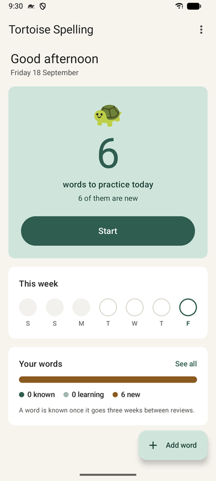
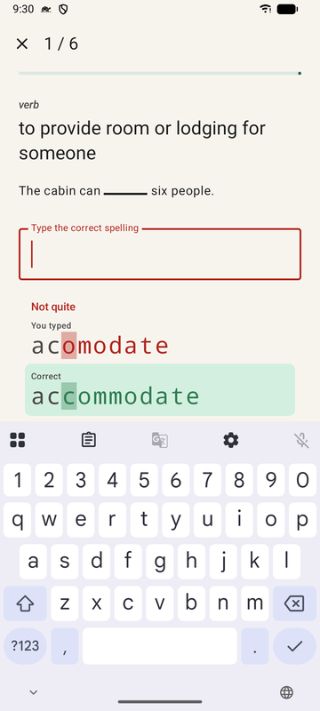
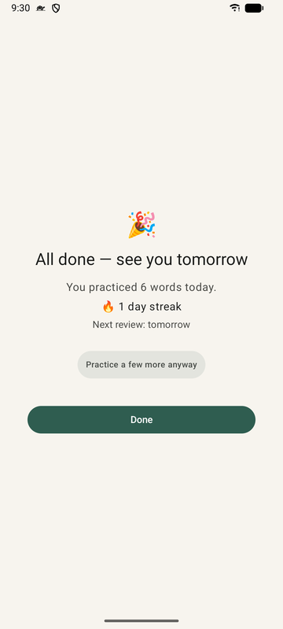
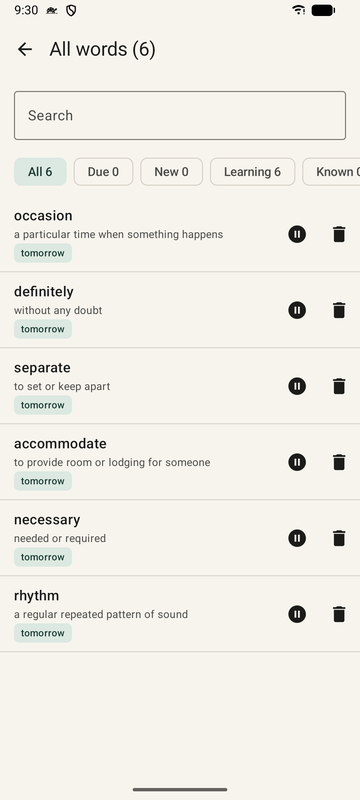

# 🐢 Tortoise Spelling

An Android app and a web app (for iPhone, iPad and any browser) for learning to spell
words you don't already know. You build your own word list, and the app drills you with
spaced repetition and a once-a-day reminder so the habit sticks. Slow and steady wins the race 🐢.

## 🐇 How it works

- 📝 **Your words, not a canned list.** Add the words you want to learn; a ready-made prompt
  goes into any chat AI you already use and its answer is pasted back, or you type them
  yourself. A word can have several
  definitions, other forms ("ran", "practise") and several example sentences.
- ✍️ **You spell it from memory.** Each review shows the definition and an example
  sentence with the word blanked out — no multiple choice. Sentences rotate, so a word
  with several examples is asked in turn, in the form each one uses.
- 🔊 **Hear the word.** Tap the speaker to hear the word spoken by your phone's or
  browser's own voice.
- ✅ **Immediate correction.** A miss shows a character-level diff, then makes you
  retype the word correctly before moving on. If the word itself was wrong, Edit word
  fixes it and the miss doesn't count.
- 🐢 **Spaced repetition (SM-2).** Correct spellings push the word further out
  (1 day → 6 → 17 → 49 → 147 → yearly); a miss brings it back tomorrow. See
  [Spaced repetition](#-spaced-repetition) below.
- 🏁 **A real finish line.** Sessions end with an explicit "all done" screen;
  an optional "practice more" mode doesn't touch your schedule.
- 🔔 **Daily reminder.** One local notification, only when words are due. On Android
  13+ the app asks for notification permission once you've added your first word.

Everything works offline with no account and no API key.
There are no ads, no analytics and no tracking: see the [privacy policy](PRIVACY.md).

### 🔓 Password managers

The answer box is a password field, so that Gboard and other keyboards can't
autocorrect or suggest the word you're trying to spell (the text isn't hidden —
you can see what you type). The side effect is that password managers may offer to
save your spellings, or pop up an autofill prompt mid-review.

The fix is to add Tortoise Spelling to your password manager's block list. In
Bitwarden, for example: **Settings → Autofill → Block auto-fill**, then add

```
androidapp://io.github.dontpanic345.tortoisespelling
```

## 🐰 Spaced repetition

Tortoise Spelling schedules reviews with **SM-2**, the algorithm behind apps like
Anki 🃏 — reviewing a word right as you're about to forget it.

- 🎯 **Per-word schedule.** Each word tracks its own repetition count, ease factor,
  and due date.
- ✅ **Right → interval grows.** 1 day, then 6, then multiplied by the ease factor
  each time, capped at a year. The ease factor starts at 2.5 and goes up by 0.1 with
  every first-try spelling, so a word you always get right comes back after 1, 6, 17,
  49 and 147 days, then yearly: reviews on days 1, 7, 24, 73 and 220 after you first
  see it. The ⓘ button on Home shows the same gaps.
- ❌ **Wrong → resets to tomorrow**, and the ease factor drops by 0.32, so the
  gaps grow more slowly afterwards. Getting it right only on the retype still counts as
  wrong.
- 🎲 **Fuzzed intervals** so words added together don't all come due the same day:
  gaps of 3 days or more move by up to a day either way, or 5% once that is more.
- 🐰🐇 **Two rabbits, one tortoise.** The hares sprint ahead early, but SM-2 makes
  sure the tortoise 🐢 wins: small, correctly-spaced daily reviews beat cramming.
- 🌱 **New words trickle in.** Adding a whole bunch at once? Limit how many new words
  you get each day in ⚙️ Settings so you don't get overwhelmed.

## 📱 Screens

| Today | Review | Finished | Word list |
|---|---|---|---|
|  |  |  |  |

## 🤖 Word lookup with any chat AI

When you add or edit a word, tap **Copy prompt**, paste it into any chat AI you already
use (Claude, ChatGPT, …), then tap **Paste answer** and paste its reply back. The app
checks it and fills in the word's definitions, forms and example sentences, which you can
still edit before saving. The app never contacts the chat AI itself.

### 🔒 Data safety

- Backup export carries a version; importing a newer-format backup is refused
  rather than half-read. Import merges, so restoring a backup never undoes progress.

## 🌐 Web app (iPhone, iPad and any browser)

There is also a web app at <https://dontpanic345.github.io/TortoiseSpelling/>. It does
everything the Android app does, including the daily reminder, and works offline once opened.
Words stay in that browser on that device, so export a backup now and then; backups move
between the two apps.

### 📲 Saving it to the Home Screen on iPhone and iPad

Saved to the Home Screen, it opens full screen like an app, and it can send the daily
reminder, which Safari can't do from an ordinary tab. It needs iOS or iPadOS 16.4 or newer.

1. Open <https://dontpanic345.github.io/TortoiseSpelling/> in **Safari**.
2. Tap **Share** (the square with an arrow pointing up). On iPhone it's in the toolbar at the
   bottom; on iPad, at the top right. In newer versions of Safari it may be behind the
   **⋯** button next to the address bar.
3. Scroll down and tap **Add to Home Screen**. If it isn't in the list, tap **Edit Actions**
   at the bottom and add it.
4. Leave **Open as Web App** on, if it's shown, and tap **Add**.
5. Open Tortoise Spelling from the new icon on the Home Screen, and turn the reminder on from
   Home or Settings.

The Home Screen app keeps its own words, separate from the Safari tab. Add your words
there, or if you started in Safari, export a backup from Safari's Settings and import it in
the Home Screen app.

On a Mac, Safari's **File → Add to Dock** does the same. In Chrome or Edge, use **Install**
in the address bar or menu.

## 📦 Releases

There's no Play Store listing: releases are signed APKs on the GitHub Releases page,
installed by sideloading. What changed in each version is in [CHANGELOG.md](CHANGELOG.md).

To cut one:

1. Check that [CHANGELOG.md](CHANGELOG.md) lists the changes under **[Unreleased]**.
2. Bump the version. This raises `versionName` (major, minor or patch) and `versionCode`
   in `app/build.gradle.kts`, and moves the notes under a heading dated today:

   ```bash
   node scripts/bump-version.mjs minor
   ```

3. Commit, and merge to main.

On every push to main, the [release workflow](.github/workflows/release.yml) checks
whether `versionName` has been released yet. If not, it refuses a version that doesn't
raise `versionCode` or has no changelog notes, runs the [CI](.github/workflows/ci.yml)
tests and a smoke test of the R8-minified build on an emulator, then builds that APK, signs it
with the keystore held in the repo's Actions secrets, and publishes it with that version's
changelog section as the release notes, creating the `v<versionName>` tag as it does. Every future update must be signed with that
same keystore, so keep an offline backup of it.
